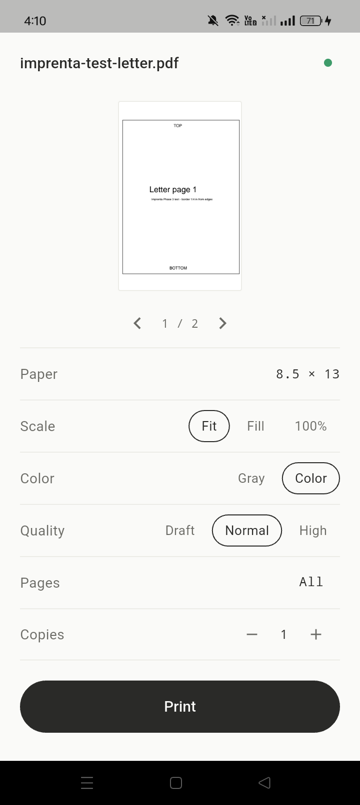
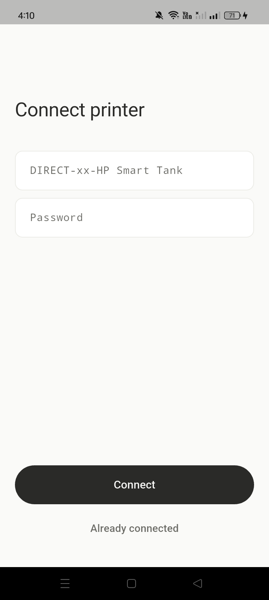

# Imprenta

**Live demo:** [Download the APK (v1.0.0)](https://github.com/dewdew-del/imprenta/releases/tag/v1.0.0). Android app, install it on an Android 10+ phone.

Print PDFs and photos from an Android phone to an HP Smart Tank 580 at the paper size you actually loaded: 8.5 × 13 (Long), Legal, Letter, A4 or a custom size. Nothing gets cut off at the bottom.

<p> </p>

## The problem I solved

At school we print on 8.5 × 13 ("Long") bond paper. From the laptop, the HP driver prints it fine. From a phone, every app (HP Smart, Mopria, Android's own print service) falls back to Letter or A4, so the last inch of every page gets cropped.

The printer itself supports Long and Legal. The phone's print system just never asks for them. Imprenta skips Android's print service and talks to the printer directly over WiFi Direct. It asks for the exact paper size, lays each page out at that size, and sends the job itself.

## How it works

- **WiFi Direct:** joins the printer's `DIRECT-xx` network (Kotlin, `WifiNetworkSpecifier`) and sends requests over that network on purpose, because Android sends traffic over mobile data when the WiFi has no internet.
- **IPP, written by hand:** a small IPP/1.1 encoder and decoder in Dart (`lib/ipp/ipp.dart`) for Get-Printer-Attributes, Print-Job, Get-Jobs, Get-Job-Attributes and Cancel-Job, plus `media-col` for custom sizes.
- **PWG raster:** this printer doesn't accept PDF, so every page is drawn at 300 dpi and encoded as PWG raster (grayscale or RGB, PackBits compression) in `lib/print/pwg_raster.dart`.
- **Layout:** Fit, Fill or 100%. Landscape pages turn sideways automatically. The preview shows the page exactly where it will land on the sheet.

## Features

- Pick a PDF, JPG or PNG, or share one into Imprenta from any app
- Paper: Letter, A4, 8.5 × 13, Legal, plus saved custom sizes (3.5–8.5 in wide, 5–14 in tall)
- Page range (`1-3, 5`), copies, color or grayscale, draft/normal/high quality
- Live job status, paper/ink/jam warnings, cancel
- Waits for a busy printer and clears its own stuck jobs
- No account, no internet, no server. Everything runs on the phone.

## Build

Requires Flutter (stable) and a physical Android phone (WiFi Direct doesn't work in the emulator).

```
flutter test
flutter build apk --release
```

## Limits

- Tested on one printer: HP Smart Tank 580-590 series. Other IPP Everywhere printers should work but aren't tested.
- Word files aren't converted. Export them to PDF from Word or Google Docs first.
- Very long photo-heavy jobs are held in memory and could run out on low-RAM phones.
